# Vouch - Autonomous Threat & Fraud Intelligence Engine

> Multi-modal forensic investigation of user-forwarded suspicious messages (WhatsApp, Telegram, REST). Evidence-ledger based, auditable, and abstains when evidence is insufficient.

[](https://www.python.org/downloads/)
[](docs/ARCHITECTURE.md)

---

## Overview

Vouch investigates user-forwarded suspicious messages as forensic artifacts - text, URLs, APKs, documents, images - and produces an evidence-backed, auditable report.

The design separates two things that are usually tangled together:

- A deterministic pipeline that canonicalizes input, extracts typed entities, and appends observations to an append-only ledger.
- A task-delegated investigation runtime that reasons over that ledger under hard limits, where every conclusion is grounded in a ledger record.

Nothing in the runtime can invent evidence. If the limits run out, the scope is uncovered, or the evidence is insufficient, the only permitted answer is `Inconclusive`.

Decision states: `Malicious` | `Suspicious` | `Benign` | `Inconclusive`.

## Architecture

```mermaid
flowchart TB
    IN["Input Artifacts<br/>message · URL · APK · document · image · video"]

    subgraph PRE["Deterministic Pipeline"]
        direction TB
        CAN["Canonicalization<br/>NFKC · confusable skeleton · script profile"]
        ENT["Typed Entity Extraction"]
        TRI["Triage &amp; Cache Hierarchy<br/>tier gate - decides what reaches the runtime"]
        MOD["Modality Analysis<br/>artifact-specific extraction"]
        FS["Fact Service<br/>IFSC · phone · domain · feeds"]
        TR["Tool Registry<br/>available tools + execution policies"]
        SK["Modality Skills Repository<br/>interpretation rubrics per modality"]
    end

    LED[("Append-only Evidence Ledger<br/>observations · results<br/>hypotheses · verification events")]

    subgraph RT["Investigation Runtime - sandboxed · resource-limited"]
        direction TB
        JEV["Case Orchestrator<br/>plan · partition · schedule · coverage state"]
        W["Independent Workers<br/>disjoint evidence · disjoint tools<br/>own the investigation loop"]
        SYN["Cross-artifact Synthesis"]
        GT["Deterministic Gate<br/>adds findings · never overturns"]
        AV["Agent Verifier<br/>support · insufficiency · contradiction"]
    end

    LIM["Hard Limits<br/>iterations · model calls · tool calls · time · resources"]
    OUT["Decision & Report<br/>Malicious · Suspicious · Benign · Inconclusive"]

    IN --> CAN --> ENT --> TRI
    TRI --> MOD
    MOD --> FS
    TRI ==>|"gated entry"| JEV

    MOD -.->|"append"| LED
    FS -.->|"append"| LED

    TR -.->|"capabilities"| W
    SK -.->|"rubric"| W
    LIM -.-> JEV
    LIM -.-> W

    JEV ==>|"task envelope"| W
    LED -.->|"role-scoped read"| W
    W ==>|"hypotheses"| LED
    W ==>|"findings"| SYN
    W ==>|"findings"| GT

    SYN ==>|"claims"| GT
    GT ==>|"passes"| AV
    AV ==>|"verification events"| LED
    AV ==>|"insufficient: follow-up"| JEV
    AV ==>|"resolved"| OUT
    JEV ==> OUT

    classDef gate fill:#2a1a3e,stroke:#7a4a9e
    class GT gate
```



For layer responsibilities, ledger record families, task-envelope fields, and the full invariant table, see [docs/ARCHITECTURE.md](docs/ARCHITECTURE.md).

## Codebase Organization

```text
src/vouch/
├── api/             # FastAPI intake: verified webhooks, transactional outbox
├── db/              # SQLAlchemy async models and session factory
├── ingestion.py     # Event, IncomingMessage, AttachmentMetadata, Channel
├── security.py      # TrustLevel, Provenance, EntityRef
├── preprocessing/   # Canonicalization and typed entity extraction
├── router.py        # Modality routing and media fetch
├── stream.py        # Redis Streams service
├── worker.py        # Stream consumer pool
├── pipeline.py      # adapt -> preprocess -> route -> fan-out -> decision
├── ledger/          # Append-only evidence contract
├── tools/           # Registry, policy, guardrails, rate limiting
│   └── facts/       # URLhaus, ThreatFox, OpenPhish, RDAP, IFSC, urlscan, VirusTotal
├── agents/          # Model provider and typed agent contracts
├── skills/          # Modality skills repository (placeholder)
├── decision.py      # RiskLevel, Verdict, DecisionRecord
├── response.py      # Grounded response templates
├── config.py        # pydantic-settings configuration
├── logger.py        # Structured JSON logging
├── telemetry.py     # OpenTelemetry and Pyroscope wiring
└── utils.py         # Retry and misc helpers
```

## Development Setup

### Prerequisites

- Python 3.13
- [uv](https://github.com/astral-sh/uv)

### Install

```bash
uv sync
```

### Run

```bash
uv run uvicorn vouch.api.server:app --reload   # API
uv run python -m vouch.api.outbox              # outbox relay
uv run python -m vouch.worker                   # stream consumer pool
uv run alembic upgrade head                    # database migrations
```

### Tests

```bash
uv run pytest tests/ -q
```

### Environment

Create a `.env` file with the variables your deployment needs. Key variables:

| Variable | Purpose |
|---|---|
| `POSTGRES_URL` | Database connection |
| `REDIS_URL` | Event stream connection |
| `WHATSAPP_SECRET` | Webhook signature verification |
| `TELEGRAM_WEBHOOK_SECRET` | Telegram secret-token verification |
| `WHATSAPP_ACCESS_TOKEN` | Outbound replies |
| `ABUSE_CH_AUTH_KEY` | URLhaus and ThreatFox feeds (optional) |
| `VIRUSTOTAL_API_KEY` | VirusTotal lookups (optional) |
| `URLSCAN_API_KEY` | urlscan lookups (optional) |
| `FACT_PROFILE` | `core` (default) or `extended` |

### Local stack

```bash
docker compose -f docker/docker-compose.yml up -d
docker compose -f docker/docker-compose.yml -f docker/compose.dev.yml up -d  # hot reload
```

| Service | URL |
|---|---|
| API | http://127.0.0.1:8000 |
| Grafana | http://127.0.0.1:3000 |
| Prometheus | http://127.0.0.1:9090 |
| Tempo | http://127.0.0.1:3200 |
| Pyroscope | http://127.0.0.1:4040 |
