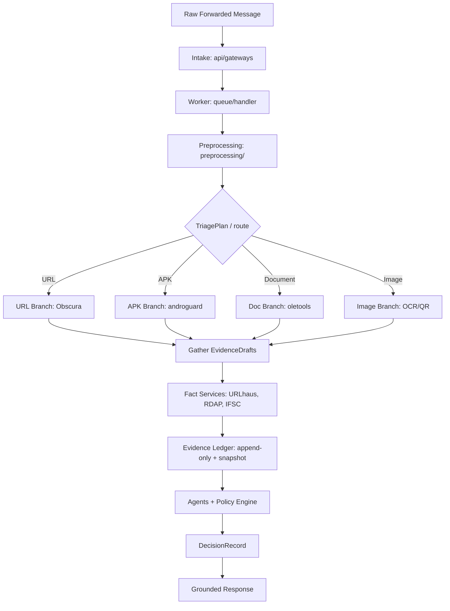

# Vouch — Autonomous Threat & Fraud Intelligence Engine

> Multi-modal forensic investigation of user-forwarded suspicious messages (WhatsApp, Telegram, REST): evidence-ledger based, auditable, abstains when evidence is insufficient.

[](https://www.python.org/downloads/)
[](docs/ARCHITECTURE.md)
[](LICENSE)

---

## 1. Overview

Vouch investigates user-forwarded suspicious messages (WhatsApp, Telegram, REST) as forensic artifacts — message text, URLs, APKs, documents, and images — and produces an evidence-backed, auditable verdict.

### Features

- Unicode-deobfuscated canonicalization (NFKC, zero-width strip, confusable skeleton, script profile)
- Typed entity extraction (UPI VPA, IFSC, phone, amount, URL, email)
- Async fan-out modality branches: URL sandbox, APK static analysis, DOC parsing, image OCR/QR
- TTL-cached fact layer (URLhaus, RDAP, Razorpay IFSC, threat feeds)
- Immutable, append-only evidence ledger with provenance and trust levels
- Asymmetric multi-agent investigation over typed claims (planned)
- Deterministic policy engine producing `DecisionRecord`s with claim-ID grounded responses (planned)

---

## 2. Architecture Blueprint



For the exhaustive specification, state transition tables, and fallback matrices, see [docs/ARCHITECTURE.md](docs/ARCHITECTURE.md).

---

## 3. Codebase Organization

```text
src/vouch/
├── api/                # Intake: gateways, routes, middlewares, server
├── db/                 # SQLAlchemy models (Submission, Investigation, BranchJob), session
├── ingestion/          # IncomingMessage, Event contracts
├── queue/              # Redis stream: stream, handler, worker pool
├── preprocessing/      # Adapters, canonicalization, entity extraction, entities
├── triage/             # Cache tiers + re-validator (planned)
├── branches/           # 4A URL · 4B APK · 4C DOC · 4D IMAGE, BranchJob
├── facts/              # Threat feeds, RDAP, IFSC resolution (planned)
├── ledger/             # Append-only Evidence, InvestigationSnapshot
├── agents/             # Adversarial agent teams (planned)
├── decision/           # Deterministic policy engine, DecisionRecord
├── response/           # Grounded response templates (planned)
├── security/           # TrustLevel, Provenance, EntityRef
└── worker/             # Stream consumer, handler dispatcher
```

---

## 4. Development Setup

### Prerequisites
* Python 3.12+
* [uv](https://github.com/astral-sh/uv) or standard Python `venv`

### Installation
```bash
git clone https://github.com/ojas/vouch.git
cd vouch
python3 -m venv .venv
source .venv/bin/activate
pip install -e .
```

### Running Test Suite
```bash
pytest tests/ -v
```
