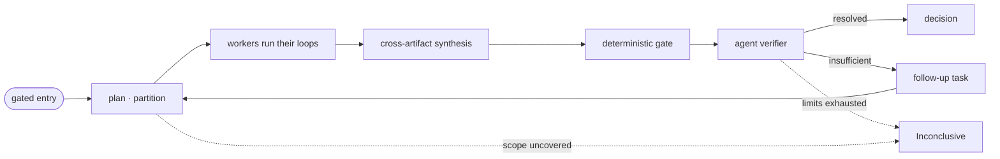

# Vouch: Multi-Modal Forensic Investigation Engine
## Architecture Specification (v4.0 — Task-Delegated Investigation Runtime)

---

## 1. System

```mermaid
flowchart TB
    IN["Input Artifacts<br/>message · URL · APK · document · image · video"]

    subgraph PRE["Deterministic Pipeline"]
        direction TB
        CAN["Canonicalization<br/>NFKC · confusable skeleton · script profile"]
        ENT["Typed Entity Extraction"]
        TRI["Triage &amp; Cache Hierarchy<br/>tier gate — decides what reaches the runtime"]
        MOD["Modality Analysis<br/>artifact-specific extraction"]
        FS["Fact Service<br/>IFSC · phone · domain · feeds"]
        TR["Tool Registry<br/>available tools + execution policies"]
        SK["Modality Skills Repository<br/>interpretation rubrics per modality"]
    end

    LED[("Append-only Evidence Ledger<br/>observations · results<br/>hypotheses · verification events")]

    subgraph RT["Investigation Runtime — sandboxed · resource-limited"]
        direction TB
        JEV["Case Orchestrator<br/>plan · partition · schedule · coverage state"]
        W["Independent Workers<br/>disjoint evidence · disjoint tools<br/>own the investigation loop"]
        SYN["Cross-artifact Synthesis"]
        GT["Deterministic Gate<br/>adds findings · never overturns"]
        AV["Agent Verifier<br/>support · insufficiency · contradiction"]
    end

    LIM["Hard Limits<br/>iterations · model calls · tool calls · time · resources"]
    OUT["Decision &amp; Report<br/>Malicious · Suspicious · Benign · Inconclusive"]

    IN --> CAN --> ENT --> TRI
    TRI --> MOD
    MOD --> FS
    TRI ==>|"gated entry"| JEV

    MOD -.->|"append"| LED
    FS -.->|"append"| LED

    TR -.->|"capabilities"| W
    SK -.->|"rubric"| W
    LIM -.-> JEV
    LIM -.-> W

    JEV ==>|"task envelope"| W
    LED -.->|"role-scoped read"| W
    W ==>|"hypotheses"| LED
    W ==>|"findings"| SYN
    W ==>|"findings"| GT

    SYN ==>|"claims"| GT
    GT ==>|"passes"| AV
    AV ==>|"verification events"| LED
    AV ==>|"insufficient: follow-up"| JEV
    AV ==>|"resolved"| OUT
    JEV ==> OUT

    classDef gate fill:#2a1a3e,stroke:#7a4a9e
    class GT gate
```



---

## 2. Layers and responsibilities

| Layer | Responsibility |
|---|---|
| **Canonicalization** | Unicode forms, confusable skeleton, script profile, mixed-script flags |
| **Typed Entity Extraction** | Typed entities with spans, extractor, version, confidence |
| **Triage & Cache** | Tier 0–4. Decides which submissions reach the runtime |
| **Modality Analysis** | Artifact-specific extraction per modality |
| **Fact Service** | External intelligence lookups → observations |
| **Tool Registry** | Available tools and execution policies |
| **Modality Skills Repository** | Per-modality interpretation rubrics |
| **Evidence Ledger** | Append-only record of everything observed, proposed, and verified |
| **Case Orchestrator** | Decides what to investigate and what runs next. Holds case state and coverage |
| **Independent Workers** | Own the investigation loop for an assigned objective |
| **Cross-artifact Synthesis** | Combines findings across artifacts into cross-artifact claims |
| **Deterministic Gate** | Structural checks. Adds findings; never overturns the agent |
| **Agent Verifier** | Rules support, insufficiency, contradiction |

---

## 3. Ledger record families

| Family | Written by | Trust | Read by | Lifecycle |
|---|---|---|---|---|
| `Observation` | Modality analysis, Fact Service | `DETERMINISTIC`, `EXTERNAL_SOURCE` | all roles | immutable on write |
| `Result` | Analysis tools | `DETERMINISTIC` | all roles | immutable on write |
| `Hypothesis` | Workers, synthesis | `MODEL_OUTPUT` | gate, verifier | pending → verified / refuted |
| `VerificationEvent` | Gate, verifier | `DETERMINISTIC`, `MODEL_OUTPUT` | gate, verifier, orchestrator | append-only |

**Role-scoped reads.** Enforced at the read API.

```
ledger.read(role=WORKER)        -> observations + results
ledger.read(role=GATE)          -> + hypotheses
ledger.read(role=VERIFIER)      -> + hypotheses + verification events
ledger.read(role=ORCHESTRATOR)  -> observations + results + verification outcomes
```

**Controlled appends.** A worker appends `Hypothesis` records tagged with its own `task_id`, and nothing else. It never writes observations, results, or verification events.

---

## 4. Runtime structures

**Task envelope** — the unit of delegation. Delegation is at task level, never at individual tool calls.

| Field | Purpose |
|---|---|
| `task_id`, `case_id`, `round_no` | identity |
| `objective` | what this task must establish |
| `scope_refs` | the evidence slice this worker may read |
| `allowed_tools` | intersected with the skill's declared tools |
| `coverage_intent` | what was meant to be examined |
| `limits` | iterations · model calls · tool calls · time · resources |

**Capabilities.** Least privilege by injection: a worker receives bound tool references, never a tool list it can look up. A tool beyond its scope does not resolve.

**Independence.** The orchestrator partitions work and determines which investigations are independent. That partition is itself appended to the ledger.

**Cross-artifact synthesis** runs once worker findings are available. Its claims enter the ledger as ordinary claims and face the same gate and verifier as every other claim.

---

## 5. Runtime flow



1. Triage admits a submission.
2. Orchestrator partitions scope into tasks, records the independence decision and coverage intents.
3. Workers run their own investigation loops under their task envelopes.
4. Synthesis combines findings into cross-artifact claims.
5. Deterministic gate adds structural findings.
6. Agent verifier rules on support, insufficiency, and contradiction.
7. Insufficiency produces a follow-up task and a new round.
8. Decision is issued from verified findings.

---

## 6. Invariants

| Invariant | Mechanism |
|---|---|
| Workers are independent | Disjoint evidence scope + disjoint tool scope; role-scoped reads |
| No worker sees another's reasoning | Role-scoped reads exclude hypotheses from worker role |
| Orchestrator cannot exceed limits | Limits enforced below the orchestrator, not by it |
| Fail-closed | Exhaustion of any limit yields `Inconclusive`, never a verdict |
| Gate cannot overrule the agent | Gate adds findings only; it never overturns |
| Synthesis is verified | Synthesis claims pass the same gate and verifier |
| No verdict without coverage | Uncovered scope is recorded and forces `Inconclusive` |
| Untrusted bytes never reach a privileged component | Modality analysis holds attacker bytes; workers receive only records |

**Decision states.** `Malicious` · `Suspicious` · `Benign` · `Inconclusive`.

`Inconclusive` is the sole terminal state for every exhaustion path: limits reached, scope uncovered, or evidence insufficient at round bound.
