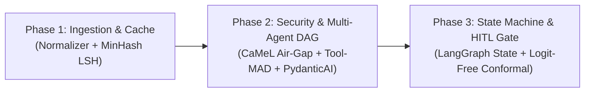

# Vouch — Engineering & Research Resources (2024–2026 Curriculum)

> **Curriculum Scope:** This document catalogs the foundational papers, architectural blueprints, and engineering standards required to build **Vouch**. Filtered specifically for a **student engineer building a production system**, this list completely omits outdated 2023-era agent paradigms (such as unstructured chatbot debates or loose string prompts) in favor of modern (2024–2026) capability security, asymmetric tool-augmented debate, type-safe state graphs, and logit-free conformal prediction.
> 
> *All 12 resources listed have been verified via live HTTP status checks (200 OK).*

---

## 1. Prescribed Step-by-Step Reading Order

Do not read these all at once. Follow this 3-phase curriculum aligned with the implementation milestones:

| Order | Resource | Estimated Time | What You Learn Before Writing Code |
|:---:|---|:---:|---|
| **1** | [AppCheck: Unicode Normalization Vulnerabilities](#1-appcheck-unicode-normalization-vulnerabilities--special-k) | 20 min | Why `NFKC` must run before regex extraction and validation. |
| **2** | [Unicode Technical Report #39](#2-unicode-technical-report-39-unicode-security-mechanisms) | 15 min | How to fold confusables and homoglyphs into canonical ASCII. |
| **3** | [Stanford CS246: MMDS Chapter 3](#3-stanford-cs246-mining-of-massive-datasets--ch-3) | 35 min | The intuition of Shingles, MinHash signatures, and LSH bands. |
| **4** | [Datasketch MinHash LSH Docs](#4-datasketch-minhash-lsh-python-documentation) | 10 min | How to implement the 128-permutation cache index in Python. |
| **5** | [Google DeepMind: CaMeL (2025)](#5-google-deepmind-camel-defeating-prompt-injections-by-design) | 25 min | The mathematical capability boundary (Quarantined vs Privileged). |
| **6** | [OWASP Top 10 for LLM: LLM01 (2025)](#6-owasp-top-10-for-llm-llm01---prompt-injection-2025-edition) | 15 min | Real-world indirect prompt injection attack surfaces. |
| **7** | [Tool-MAD: Tool-Augmented Debate (2026)](#7-tool-mad-a-multi-agent-debate-framework-with-diverse-tool-augmentation) | 25 min | Why debate needs asymmetric tools + a quantitative judge. |
| **8** | [Can LLM Agents Really Debate? (2025)](#8-can-llm-agents-really-debate-a-controlled-study) | 20 min | The empirical ceiling of multi-agent debate (why 2 debaters max). |
| **9** | [PydanticAI Architecture Documentation](#9-pydanticai-production-agent-framework-built-on-pydantic) | 20 min | Strict schema validation and dependency injection for agents. |
| **10** | [Eugene Yan: Production LLM Patterns](#10-eugene-yan-patterns-for-building-llm-based-systems--products) | 25 min | Deterministic validation gates (`CODE_GATE`) and latency budgets. |
| **11** | [LangGraph: Workflows as State Graphs](#11-langgraph-multi-agent-workflows-as-state-graphs) | 20 min | Cyclic state machines with checkpoints and pause/resume logic. |
| **12** | [API is Enough: Logit-Free Conformal Prediction (2024)](#12-api-is-enough-conformal-prediction-for-llms-without-logit-access) | 25 min | How to generate statistically guaranteed prediction sets via APIs. |

---

## 2. Resource Catalog & Deep Dive

### Phase 1: Ingestion, Obfuscation & Fast Deduplication

#### 1. AppCheck: Unicode Normalization Vulnerabilities & Special K
* **Source:** [https://appcheck-ng.com/unicode-normalization-vulnerabilities/](https://appcheck-ng.com/unicode-normalization-vulnerabilities/)
* **Type:** Practical Security Engineering Guide
* **Core Concept:** Explains the mechanics of Unicode normalization: Canonical Equivalence (`NFC`/`NFD`) vs Compatibility Equivalence (`NFKC`/`NFKD`). Demonstrates real attack payloads where attackers use full-width glyphs (e.g. `９８７６` or `＠`) or multi-byte ligatures to slip malicious content past filters. Crucially establishes why **`NFKC` normalization must execute prior to regex entity extraction and security checks**.
* **Vouch Module:** `src/vouch/normalizer.py`
* **What to Read:** Skim the history of Unicode; read closely the sections on **Compatibility Equivalence** and **Normalization Attacks**.

#### 2. Unicode Technical Report #39: Unicode Security Mechanisms
* **Source:** [https://www.unicode.org/reports/tr39/](https://www.unicode.org/reports/tr39/)
* **Type:** Official Unicode Consortium Standard
* **Core Concept:** The authoritative engineering specification for confusable character detection and mixed-script spoofing. It provides the algorithmic basis for folding visually indistinguishable characters across alphabets (e.g., Cyrillic `а` / `U+0430` vs Latin `a` / `U+0061`) into canonical ASCII representations.
* **Vouch Module:** `src/vouch/normalizer.py` (`confusable_homoglyphs` mapping)
* **What to Read:** Skip the administrative front-matter. Read **Section 4: Confusable Detection**.

#### 3. Stanford CS246: Mining of Massive Datasets — Ch. 3: Finding Similar Items
* **Authors:** Jure Leskovec, Anand Rajaraman, Jeffrey D. Ullman (Stanford University)
* **Source:** [http://infolab.stanford.edu/~ullman/mmds/ch3.pdf](http://infolab.stanford.edu/~ullman/mmds/ch3.pdf)
* **Type:** Undergraduate Computer Science Textbook Chapter
* **Core Concept:** The cleanest, most intuitive explanation of near-duplicate detection without the resource overhead of heavy vector databases:
  1. **$k$-Shingling:** Converting normalized message text into sets of character $n$-grams.
  2. **Minhashing:** Compressing large token sets into compact, fixed-size signatures (128 integers) that provably preserve Jaccard similarity.
  3. **Locality-Sensitive Hashing (LSH):** Partitioning signatures into bands and hash buckets to find candidate near-duplicate scam templates in sub-millisecond $O(1)$ time.
* **Vouch Module:** `src/vouch/fingerprint.py`
* **What to Read:** Read **Sections 3.1 to 3.4** (Pages 73–94). The matrix diagrams make the signature permutations immediately obvious.

#### 4. Datasketch: MinHash LSH Python Documentation
* **Author:** Eric Zhu
* **Source:** [https://ekzhu.com/datasketch/lsh.html](https://ekzhu.com/datasketch/lsh.html)
* **Type:** Production Python Library Documentation
* **Core Concept:** The battle-tested Python implementation reference for storing, querying, and indexing MinHash signatures. Demonstrates how to configure Jaccard similarity thresholds, insert signatures, and query candidate matches using in-memory or Redis backends.
* **Vouch Module:** `src/vouch/fingerprint.py` (LSH indexing service)
* **What to Read:** Read the **Quickstart** and the section on **MinHash LSH Indexing**.

---

### Phase 2: Capability Security & Asymmetric Multi-Agent DAG

#### 5. Google DeepMind: CaMeL — Defeating Prompt Injections by Design
* **Authors:** Edoardo Debenedetti, Ilia Shumailov et al. (Google DeepMind)
* **Date:** March 2025
* **Source:** [https://arxiv.org/abs/2503.18813](https://arxiv.org/abs/2503.18813)
* **Type:** Frontier Security Research Paper
* **Core Concept:** Moves beyond naive "heuristic filters" and introduces a formal capability-based security architecture for LLM agents:
  1. **Quarantined LLM (Low-Privilege):** Ingests raw, untrusted external content (e.g. suspicious messages, scraped web complaints). Has **zero tools and zero network access**, outputting strictly schema-validated representations.
  2. **Privileged LLM (High-Privilege):** Orchestrates tools, database mutations, and decisions. It **never reads raw user text directly**, only consuming validated structs.
* **Vouch Module:** `src/vouch/airgap_extract.py` and `Strict Structured Blackboard`
* **What to Read:** Read **Section 1 (Introduction)**, **Section 2 (Threat Model)**, and **Section 3 (CaMeL Architecture)**. Skip the benchmark evaluation details on AgentDojo.

#### 6. OWASP Top 10 for LLM: LLM01 - Prompt Injection (2025 Edition)
* **Source:** [https://genai.owasp.org/llmrisk/llm01-prompt-injection/](https://genai.owasp.org/llmrisk/llm01-prompt-injection/)
* **Type:** Industry Security Standard
* **Core Concept:** Up-to-date real-world attack vectors for Indirect Prompt Injection (IPI) via untrusted search results and forwarded messages. Defines strict data-flow isolation checklists to ensure untrusted inputs cannot hijack execution or trigger unauthorized API actions.
* **Vouch Module:** Security boundary around `SearXNG` output ingestion and `CODE_GATE`.
* **What to Read:** Focus on **Common Scenarios** and **Prevention and Mitigation Strategies**.

#### 7. Tool-MAD: A Multi-Agent Debate Framework with Diverse Tool Augmentation
* **Authors:** Kim et al. (Yonsei University)
* **Date:** January 2026
* **Source:** [https://arxiv.org/abs/2601.04742](https://arxiv.org/abs/2601.04742)
* **Type:** Frontier Multi-Agent Research Paper
* **Core Concept:** Standard multi-agent debate fails when models debate in an ungrounded vacuum. Tool-MAD introduces two critical innovations:
  1. **Heterogeneous Tool Augmentation:** Rather than symmetric agents, agents receive asymmetric, specialized external tools (e.g., Accuser gets ThreatFox/Abuse.ch; Defender gets institutional registry verification).
  2. **Quantitative Judge:** The adjudicating model evaluates arguments using formal *Faithfulness* and *Relevance* metrics, terminating rounds when convergence is achieved.
* **Vouch Module:** `src/vouch/agents/accuser.py`, `src/vouch/agents/defender.py`, and `src/vouch/judge.py`
* **What to Read:** Read **Section 1 (Introduction)**, **Section 3 (Framework Formulation)**, and study **Figure 2**.

#### 8. Can LLM Agents Really Debate? A Controlled Study
* **Authors:** Controlled empirical study on LLM deliberation
* **Date:** February 2025
* **Source:** [https://arxiv.org/abs/2502.13175](https://arxiv.org/abs/2502.13175)
* **Type:** Critical Empirical Evaluation
* **Core Concept:** Demonstrates the failure modes of naive multi-agent debate: without strict extrinsic diversity and independent evidence gathering, agents form **"confidently incorrect echo chambers"** and suffer from problem drift. Confirms that performance degrades past 2 debaters, validating an asymmetric 2-agent + 1-judge architecture.
* **Vouch Module:** Deep investigation engine design constraints.
* **What to Read:** Read the **Abstract**, **Introduction**, and **Section 5 (Discussion & Recommendations)**.

#### 9. PydanticAI: Production Agent Framework Built on Pydantic
* **Authors:** Samuel Colvin & the Pydantic Core Team
* **Source:** [https://ai.pydantic.dev/](https://ai.pydantic.dev/)
* **Type:** Framework Architecture & Documentation
* **Core Concept:** The modern Python standard for type-safe agents. Eliminates free-form string passing between agents by enforcing:
  - Validated Pydantic models as response types.
  - Strict type hints and dependency injection for tools.
  - Deterministic validation loops that catch malformed model outputs before they reach downstream components.
* **Vouch Module:** `src/vouch/schemas.py` and `src/vouch/blackboard.py`
* **What to Read:** Read the **Introduction**, **Agents Documentation**, and **Results & Output Types**.

---

### Phase 3: Orchestration, State Machines & Calibrated Decisions

#### 10. Eugene Yan: Patterns for Building LLM-based Systems & Products
* **Author:** Eugene Yan (Principal ML Engineer)
* **Source:** [https://eugeneyan.com/writing/llm-patterns/](https://eugeneyan.com/writing/llm-patterns/)
* **Type:** Production Systems Engineering Handbook
* **Core Concept:** Pragmatic engineering guidance for production LLMs:
  - **Deterministic Validation Gates:** Intercepting model outputs with programmatic assertions before allowing downstream components to consume them.
  - **Latency Budgets:** Balancing fast-path caching with deep multi-step pipelines.
  - **Intermediate Evals:** Testing and asserting the accuracy of intermediate evidence stages rather than grading the whole system on "vibes".
* **Vouch Module:** `src/vouch/code_gate.py`
* **What to Read:** Read the sections on **Guardrails (Input/Output Validation)**, **Task Decomposition & Chaining**, and **Tool Use Defense**.

#### 11. LangGraph: Multi-Agent Workflows as State Graphs
* **Source:** [https://blog.langchain.com/langgraph-multi-agent-workflows/](https://blog.langchain.com/langgraph-multi-agent-workflows/)
* **Type:** Architectural Framework Specification
* **Core Concept:** Explains why autonomous agent loops are brittle and models multi-agent pipelines as **explicit cyclic State Graphs (DAGs with bounded transitions)**:
  - **Shared State Dictionary (Blackboard):** Agents write strictly to a common typed state object.
  - **Deterministic Edge Routing:** Code decides which agent runs next based on state conditions.
  - **Human-in-the-Loop (HITL) Checkpoints:** Native support for pausing execution at an uncertainty gate, awaiting human input, and resuming execution idempotently.
* **Vouch Module:** State machine orchestration (`RECEIVED → CACHE_CHECKED → INVESTIGATING → ADJUDICATED → DISPATCHED`).
* **What to Read:** Study the architectural diagrams comparing **Hierarchical Supervisor vs Shared State**, along with the checkpointing model.

#### 12. API is Enough: Conformal Prediction for LLMs Without Logit Access
* **Authors:** Su et al.
* **Date:** EMNLP 2024
* **Source:** [https://arxiv.org/abs/2406.02701](https://arxiv.org/abs/2406.02701)
* **Type:** Practical Uncertainty Quantification Paper
* **Core Concept:** Classical conformal prediction required direct access to internal model logit distributions, which are unavailable or uncalibrated when using modern hosted APIs (Gemini, Claude, GPT-4, or hosted vLLM). This paper demonstrates how to construct **finite-sample, mathematically guaranteed prediction sets using semantic similarity and ranking scores from black-box APIs**:
  - If the prediction set is a singleton `{"SCAM"}`: High confidence $\to$ Auto-dispatched.
  - If the prediction set is multi-class `{"SCAM", "LEGITIMATE"}`: High uncertainty $\to$ Automatically routes to the **HITL (Human-in-the-Loop) review queue**.
* **Vouch Module:** `src/vouch/uncertainty_gate.py`
* **What to Read:** Read **Section 1 (Introduction)**, **Section 2 (Problem Formulation)**, and **Section 3 (Methodology)**.

---

## 3. Distributed Systems & Reliability Engineering (DDIA & Alex Xu)

For the underlying systems engineering problems in Vouch—**idempotency, worker crashes, message queue decoupling, rate limiting, and threat graph data modeling**—the following chapters from *Designing Data-Intensive Applications (DDIA)* (2nd Edition) and *System Design Interview* (Alex Xu, Vols 1 & 2) provide surgical, battle-tested solutions.

### Surgical Chapter Breakdown

#### 1. Alex Xu (Volume 2) — Chapter 11: *Design a Payment System*
* **Focus Topic:** **Idempotency Keys & Reconciliation**
* **The Vouch Problem It Solves:** When a background worker crashes or Redis redelivers an investigation task, you risk sending duplicate Telegram/WhatsApp messages or recharging external APIs. This chapter demonstrates how to enforce database-level unique constraints on `(submission_id, dispatch_stage)` to guarantee **exactly-once external side effects** despite at-least-once message queues.
* **Vouch Module:** `src/vouch/dispatcher.py` & PostgreSQL state transactions
* **What to Read:** The subsections on **Idempotency**, **Idempotency Key Handling**, and **Reconciliation**.
* **What to Skip:** Payment clearing loops, payment processor PSP protocols, and double-entry ledger bookkeeping.

#### 2. DDIA (2nd Edition) — Chapter 11: *Stream Processing*
* **Focus Topic:** **Message Brokers & Stream-Table Duality**
* **The Vouch Problem It Solves:** Demystifies the relationship between **PostgreSQL (System of Record)** and **Redis Stream (Task Queue)**. Explains why a message broker must not serve as your database, how consumer groups and offset acknowledgments prevent message loss during worker crashes, and how events in a stream materialize into durable state tables.
* **Vouch Module:** `src/vouch/queue.py` & Celery/ARQ worker orchestration
* **What to Read:** Sections on **Messaging Systems** (Log-Based Message Brokers vs Traditional Messaging) and **Stream-Table Duality**.
* **What to Skip:** Complex stream-stream window joins and probabilistic complex event processing (CEP).

#### 3. Alex Xu (Volume 1) — Chapter 10: *Design a Notification System*
* **Focus Topic:** **Queues + Worker Pools + Third-Party Provider Decoupling**
* **The Vouch Problem It Solves:** Telegram Bot API and Meta (WhatsApp Cloud API) enforce strict outbound rate limits and experience occasional gateway timeouts. This chapter provides the architectural blueprint for placing dedicated per-provider worker queues with exponential backoff retries in front of third-party adapters.
* **Vouch Module:** `src/vouch/adapters/telegram.py` and `src/vouch/adapters/whatsapp.py`
* **What to Read:** The **High-Level Design** (Message queues, notification servers, third-party services) and the section on **Retry Mechanism & Rate Limiting**.
* **What to Skip:** User notification preference settings.

#### 4. DDIA (2nd Edition) — Chapter 2: *Data Models and Query Languages*
* **Focus Topic:** **Graph-Like Data Models (Relational vs Property Graphs)**
* **The Vouch Problem It Solves:** Vouch maintains a **Bipartite Threat Graph** linking phone numbers, UPI VPAs, domains, and scam templates. Before introducing a separate, operationally complex graph database (like Neo4j), Kleppmann explains how to model 1-hop and 2-hop entity relationships directly in PostgreSQL using adjacency tables and recursive Common Table Expressions (CTEs).
* **Vouch Module:** `src/vouch/graph.py` (Threat Graph store)
* **What to Read:** The section on **Graph-Like Data Models** (Property Graphs & Cypher).
* **What to Skip:** Network model (CODASYL), XML/document models, and Semantic Web / SPARQL triple-stores.

#### 5. Alex Xu (Volume 1) — Chapter 4: *Design a Rate Limiter*
* **Focus Topic:** **Redis Sliding Window Counter**
* **The Vouch Problem It Solves:** Vouch's FastAPI webhook is public. If an attacker floods the gateway with forwarded messages, your LLM token budget and OSINT tool quotas will be exhausted in minutes. This chapter shows how to implement a memory-efficient Redis sliding window rate limiter at the ingress boundary.
* **Vouch Module:** `src/vouch/api.py` (FastAPI intake middleware)
* **What to Read:** Section on **Rate Limiting Algorithms** (specifically Token Bucket and Sliding Window Counter) and the **Distributed Environment** section.
* **What to Skip:** Low-level iptables and network firewall rules.

---

### Suggested 2-Hour Bookshelf Reading Plan

1. **Before writing `dispatcher.py`:** Read **Alex Xu Vol 2, Ch 11** (Idempotency) — ~30 min.
2. **Before wiring Celery/ARQ to Redis:** Read **DDIA Ch 11** (Messaging Systems & Stream-Table Duality) — ~30 min.
3. **Before building messaging adapters:** Read **Alex Xu Vol 1, Ch 10** (Notification Queues) — ~20 min.
4. **Before writing `graph.py`:** Read **DDIA Ch 2** (Graph-like Data Models) — ~20 min.
5. **Before exposing the FastAPI webhook:** Read **Alex Xu Vol 1, Ch 4** (Sliding Window Rate Limiter) — ~15 min.
