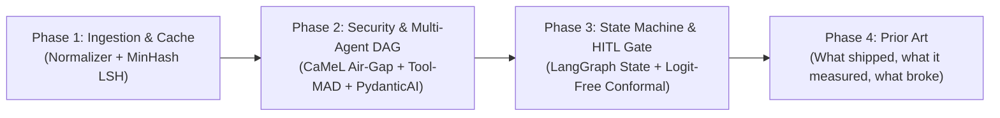

# Vouch — Engineering & Research Resources (2024–2026 Curriculum)

> **Curriculum Scope:** This document catalogs the foundational papers, architectural blueprints, and engineering standards required to build **Vouch**. Filtered specifically for a **student engineer building a production system**, this list completely omits outdated 2023-era agent paradigms (such as unstructured chatbot debates or loose string prompts) in favor of modern (2024–2026) capability security, asymmetric tool-augmented debate, type-safe state graphs, and logit-free conformal prediction.
>
> **Phase 4 is different in kind.** Phases 1–3 are *foundations* — what you need to know. Phase 4
> (entries 13–17) is *prior art* — systems that already built a multi-agent fraud/scam
> investigation product, read in source, with their measurements and their defects. Phase 4 exists
> because Vouch's central unanswered question — **does the asymmetric-tool DAG earn its ~15× token
> cost over one well-prompted call?** — is not answerable from first principles. It is only
> answerable by reading what shipped, what it measured, and where it broke. Several entries in
> Phase 4 are counter-examples on purpose.
> 
> **Citation verification status:** Every arXiv ID in this document has been checked against the
> arXiv API for **title and author match**, not HTTP status. Two entries (#8, #12) previously
> carried fabricated IDs that resolved to unrelated papers while still returning `200 OK` — see the
> correction notes inline. Non-arXiv sources (vendor docs, blog posts) are **not** content-verified
> and are marked where relevant.
>
> **Phase 4 verification status (added 2026-10-03):** entries #13–#16 were read in full, from
> source where one exists (`back/detectAgents.py`, `python-ml/agents/agent_coordinator.py`,
> `python-ml/agents/base_agent.py`, `agents.py`, `config/agents.yaml` — all cloned and read, not
> summarised from the README). Entry #14's ablation tables were read from the arXiv HTML full text.
> Entry #17's Oracle page was fetched and its visible text extracted in full; **the 60%/40%
> effectiveness figures attributed to it in the project notes do not appear in it** and have been
> retracted. The MDPI paper in the same group could not be retrieved (403 on all paths) and is
> recorded as metadata-only. One item is **not yet released** (ConScamBench-278) and one is
> **license-unclear** (AgentDroid's dataset); both are marked.

---

## 1. Prescribed Step-by-Step Reading Order

Do not read these all at once. Follow this 3-phase curriculum aligned with the implementation milestones:

| Order | Resource | Estimated Time | What You Learn Before Writing Code |
|:---:|---|:---:|---|
| **1** | [AppCheck: Unicode Normalization Vulnerabilities](#1-appcheck-unicode-normalization-vulnerabilities--special-k) | 20 min | Why `NFKC` must run before regex extraction and validation. |
| **2** | [Unicode Technical Report #39](#2-unicode-technical-report-39-unicode-security-mechanisms) | 15 min | How to fold confusables and homoglyphs into canonical ASCII. |
| **3** | [Stanford CS246: MMDS Chapter 3](#3-stanford-cs246-mining-of-massive-datasets--ch-3-finding-similar-items) | 35 min | The intuition of Shingles, MinHash signatures, and LSH bands. |
| **4** | [Datasketch MinHash LSH Docs](#4-datasketch-minhash-lsh-python-documentation) | 10 min | How to implement the 128-permutation cache index in Python. |
| **5** | [Google DeepMind: CaMeL (2025)](#5-google-deepmind-camel--defeating-prompt-injections-by-design) | 25 min | The mathematical capability boundary (Quarantined vs Privileged). |
| **6** | [OWASP Top 10 for LLM: LLM01 (2025)](#6-owasp-top-10-for-llm-llm01---prompt-injection-2025-edition) | 15 min | Real-world indirect prompt injection attack surfaces. |
| **7** | [Tool-MAD: Tool-Augmented Debate (2026)](#7-tool-mad-a-multi-agent-debate-framework-for-fact-verification-with-diverse-tool-augmentation-and-adaptive-retrieval) | 25 min | Why debate needs asymmetric tools + a quantitative judge. |
| **8** | [Can LLM Agents Really Debate? (2025)](#8-can-llm-agents-really-debate-a-controlled-study) | 20 min | The empirical ceiling of multi-agent debate (why 2 debaters max). |
| **9** | [PydanticAI Architecture Documentation](#9-pydanticai-production-agent-framework-built-on-pydantic) | 20 min | Strict schema validation and dependency injection for agents. |
| **10** | [Eugene Yan: Production LLM Patterns](#10-eugene-yan-patterns-for-building-llm-based-systems--products) | 25 min | Deterministic validation gates (`CODE_GATE`) and latency budgets. |
| **11** | [LangGraph: Workflows as State Graphs](#11-langgraph-multi-agent-workflows-as-state-graphs) | 20 min | Cyclic state machines with checkpoints and pause/resume logic. |
| **12** | [API is Enough: Logit-Free Conformal Prediction (2024)](#12-api-is-enough-conformal-prediction-for-llms-without-logit-access) | 25 min | How to generate statistically guaranteed prediction sets via APIs. |
| **13** | [streaming-fraud-intelligence: Gated Fan-Out + Deterministic Synthesis](#15-streaming-fraud-intelligence--distributed-cloud-native-fraud-detection) | 40 min | ⭐ **Copy the disagreement gate and the LLM-free final step. Reject the regex-parsed LLM output and the self-reported confidence.** |
| **14** | [AgentDroid: Multi-Agent Fraudulent-APK Detection](#13-agentdroid-a-multi-agent-framework-for-detecting-fraudulent-android-applications) | 40 min | ⭐ A dependency-triggered DAG over a shared blackboard — and `temperature=0.95` in a fraud verdict. |
| **15** | [Conversational-Scam Agentic System + ConScamBench-278](#14-an-explainable-agentic-system-for-detection-of-conversational-scams-with-summary-based-memory) | 45 min | ⭐ **The only fixed-backend component ablation of a multi-agent scam pipeline. Also why the eval corpus gap is field-wide.** |
| **16** | [minerva: AutoGen Round-Robin Scam System](#16-minerva--multi-agent-llm-system-for-digital-scam-protection) | 25 min | The naive baseline in 573 lines — disjoint tools, no shared state, turn-capped. |
| **17** | [Oracle Multi-Agent Fraud Detection on OCI](#17-oracle-learn-about-deploying-a-multi-agent-ai-fraud-detection-system-on-oci) | 15 min | Enterprise topology vocabulary. **Contains no measurements — see the retraction.** |

---

## 2. Resource Catalog & Deep Dive

### Phase 1: Ingestion, Obfuscation & Fast Deduplication

#### 1. AppCheck: Unicode Normalization Vulnerabilities & Special K
* **Source:** [https://appcheck-ng.com/unicode-normalization-vulnerabilities/](https://appcheck-ng.com/unicode-normalization-vulnerabilities/)
* **Type:** Practical Security Engineering Guide
* **Core Concept:** Explains the mechanics of Unicode normalization: Canonical Equivalence (`NFC`/`NFD`) vs Compatibility Equivalence (`NFKC`/`NFKD`). Demonstrates real attack payloads where attackers use full-width glyphs (e.g. `９８７６` or `＠`) or multi-byte ligatures to slip malicious content past filters. Crucially establishes why **`NFKC` normalization must execute prior to regex entity extraction and security checks**.
* **Vouch Module:** `src/vouch/normalizer.py`
* **What to Read:** Skim the history of Unicode; read closely the sections on **Compatibility Equivalence** and **Normalization Attacks**.

#### 2. Unicode Technical Report #39: Unicode Security Mechanisms
* **Source:** [https://www.unicode.org/reports/tr39/](https://www.unicode.org/reports/tr39/)
* **Type:** Official Unicode Consortium Standard
* **Core Concept:** The authoritative engineering specification for confusable character detection and mixed-script spoofing. It provides the algorithmic basis for folding visually indistinguishable characters across alphabets (e.g., Cyrillic `а` / `U+0430` vs Latin `a` / `U+0061`) into canonical ASCII representations.
* **Vouch Module:** `src/vouch/normalizer.py` (`confusable_homoglyphs` mapping)
* **What to Read:** Skip the administrative front-matter. Read **Section 4: Confusable Detection**.

#### 3. Stanford CS246: Mining of Massive Datasets — Ch. 3: Finding Similar Items
* **Authors:** Jure Leskovec, Anand Rajaraman, Jeffrey D. Ullman (Stanford University)
* **Source:** [http://infolab.stanford.edu/~ullman/mmds/ch3.pdf](http://infolab.stanford.edu/~ullman/mmds/ch3.pdf)
* **Type:** Undergraduate Computer Science Textbook Chapter
* **Core Concept:** The cleanest, most intuitive explanation of near-duplicate detection without the resource overhead of heavy vector databases:
  1. **$k$-Shingling:** Converting normalized message text into sets of character $n$-grams.
  2. **Minhashing:** Compressing large token sets into compact, fixed-size signatures (128 integers) that provably preserve Jaccard similarity.
  3. **Locality-Sensitive Hashing (LSH):** Partitioning signatures into bands and hash buckets to find candidate near-duplicate scam templates in sub-millisecond $O(1)$ time.
* **Vouch Module:** `src/vouch/fingerprint.py`
* **What to Read:** Read **Sections 3.1 to 3.4** (Pages 73–94). The matrix diagrams make the signature permutations immediately obvious.

#### 4. Datasketch: MinHash LSH Python Documentation
* **Author:** Eric Zhu
* **Source:** [https://ekzhu.com/datasketch/lsh.html](https://ekzhu.com/datasketch/lsh.html)
* **Type:** Production Python Library Documentation
* **Core Concept:** The battle-tested Python implementation reference for storing, querying, and indexing MinHash signatures. Demonstrates how to configure Jaccard similarity thresholds, insert signatures, and query candidate matches using in-memory or Redis backends.
* **Vouch Module:** `src/vouch/fingerprint.py` (LSH indexing service)
* **What to Read:** Read the **Quickstart** and the section on **MinHash LSH Indexing**.

---

### Phase 2: Capability Security & Asymmetric Multi-Agent DAG

#### 5. Google DeepMind: CaMeL — Defeating Prompt Injections by Design
* **Authors:** Edoardo Debenedetti, Ilia Shumailov et al. (Google DeepMind)
* **Date:** March 2025
* **Source:** [https://arxiv.org/abs/2503.18813](https://arxiv.org/abs/2503.18813)
* **Type:** Frontier Security Research Paper
* **Core Concept:** Moves beyond naive "heuristic filters" and introduces a formal capability-based security architecture for LLM agents:
  1. **Quarantined LLM (Low-Privilege):** Ingests raw, untrusted external content (e.g. suspicious messages, scraped web complaints). Has **zero tools and zero network access**, outputting strictly schema-validated representations.
  2. **Privileged LLM (High-Privilege):** Orchestrates tools, database mutations, and decisions. It **never reads raw user text directly**, only consuming validated structs.
* **Vouch Module:** `src/vouch/airgap_extract.py` and `Strict Structured Blackboard`
* **What to Read:** Read **Section 1 (Introduction)**, **Section 2 (Threat Model)**, and **Section 3 (CaMeL Architecture)**. Skip the benchmark evaluation details on AgentDojo.

#### 6. OWASP Top 10 for LLM: LLM01 - Prompt Injection (2025 Edition)
* **Source:** [https://genai.owasp.org/llmrisk/llm01-prompt-injection/](https://genai.owasp.org/llmrisk/llm01-prompt-injection/)
* **Type:** Industry Security Standard
* **Core Concept:** Up-to-date real-world attack vectors for Indirect Prompt Injection (IPI) via untrusted search results and forwarded messages. Defines strict data-flow isolation checklists to ensure untrusted inputs cannot hijack execution or trigger unauthorized API actions.
* **Vouch Module:** Security boundary around `SearXNG` output ingestion and `CODE_GATE`.
* **What to Read:** Focus on **Common Scenarios** and **Prevention and Mitigation Strategies**.

#### 7. Tool-MAD: A Multi-Agent Debate Framework for Fact Verification with Diverse Tool Augmentation and Adaptive Retrieval
* **Authors:** Seyeon Jeong, Yeonjun Choi, JongWook Kim, Beakcheol Jang
* **Date:** January 2026
* **Source:** [https://arxiv.org/abs/2601.04742](https://arxiv.org/abs/2601.04742)
* **Type:** Frontier Multi-Agent Research Paper
* **Core Concept:** Standard multi-agent debate fails when models debate in an ungrounded vacuum. Tool-MAD introduces two critical innovations:
  1. **Heterogeneous Tool Augmentation:** Rather than symmetric agents, agents receive asymmetric, specialized external tools (e.g., Accuser gets ThreatFox/Abuse.ch; Defender gets institutional registry verification).
  2. **Quantitative Judge:** The adjudicating model evaluates arguments using formal *Faithfulness* and *Relevance* metrics, terminating rounds when convergence is achieved.
* **Vouch Module:** Asymmetric collectors (`ThreatCollector` / `LegitimacyCollector`) and the
  adjudicator's convergence check.
* **Note:** Vouch borrows the *heterogeneous tool* principle but **not** the free-form debate loop —
  see `ARCHITECTURE.md` §6.1 for why contradiction detection is a function over a typed ledger
  rather than a separate agent.
* **What to Read:** Read **Section 1 (Introduction)**, **Section 3 (Framework Formulation)**, and study **Figure 2**.

#### 8. Can LLM Agents Really Debate? A Controlled Study
* **Authors:** Haolun Wu, Zhenkun Li, Lingyao Li
* **Date:** November 2025
* **Source:** [https://arxiv.org/abs/2511.07784](https://arxiv.org/abs/2511.07784)
* **Type:** Critical Empirical Evaluation
* **Core Concept:** Controlled study of multi-agent debate using the Knight-Knave-Spy logic puzzle, where ground truth is verifiable step-by-step. Documents real failure modes: susceptibility to social pressure, difficulty assessing argument quality, and **premature convergence**. Notably, it finds that **team size and diversity are positive predictors of debate success** — eloquent-but-incorrect agents can sway others.
* **Caveat:** External validity to fraud triage is nil — this is LLM logical reasoning on logic puzzles, not tool-augmented OSINT. Cite it for the *failure modes*, not for a headcount rule.
* **Vouch Module:** Deep investigation engine design constraints — specifically why an eloquent-but-wrong claim must not be able to carry a verdict on its own.
* **What to Read:** Read the **Abstract**, **Introduction**, and **Section 5 (Discussion & Recommendations)**.

> **Correction (2026-10-03):** This entry previously cited `arXiv:2502.13175` ("Towards Robust and
> Secure Embodied AI: A Survey") — an unrelated paper — and stated that the study "confirms that
> performance degrades past 2 debaters." The real paper reports the opposite direction on team
> size. Both the ID and the claim were wrong.

#### 9. PydanticAI: Production Agent Framework Built on Pydantic
* **Authors:** Samuel Colvin & the Pydantic Core Team
* **Source:** [https://ai.pydantic.dev/](https://ai.pydantic.dev/)
* **Type:** Framework Architecture & Documentation
* **Core Concept:** The modern Python standard for type-safe agents. Eliminates free-form string passing between agents by enforcing:
  - Validated Pydantic models as response types.
  - Strict type hints and dependency injection for tools.
  - Deterministic validation loops that catch malformed model outputs before they reach downstream components.
* **Vouch Module:** `src/vouch/schemas.py` and `src/vouch/blackboard.py`
* **What to Read:** Read the **Introduction**, **Agents Documentation**, and **Results & Output Types**.

---

### Phase 3: Orchestration, State Machines & Calibrated Decisions

#### 10. Eugene Yan: Patterns for Building LLM-based Systems & Products
* **Author:** Eugene Yan (Principal ML Engineer)
* **Source:** [https://eugeneyan.com/writing/llm-patterns/](https://eugeneyan.com/writing/llm-patterns/)
* **Type:** Production Systems Engineering Handbook
* **Core Concept:** Pragmatic engineering guidance for production LLMs:
  - **Deterministic Validation Gates:** Intercepting model outputs with programmatic assertions before allowing downstream components to consume them.
  - **Latency Budgets:** Balancing fast-path caching with deep multi-step pipelines.
  - **Intermediate Evals:** Testing and asserting the accuracy of intermediate evidence stages rather than grading the whole system on "vibes".
* **Vouch Module:** `src/vouch/code_gate.py`
* **What to Read:** Read the sections on **Guardrails (Input/Output Validation)**, **Task Decomposition & Chaining**, and **Tool Use Defense**.

#### 11. LangGraph: Multi-Agent Workflows as State Graphs
* **Source:** [https://blog.langchain.com/langgraph-multi-agent-workflows/](https://blog.langchain.com/langgraph-multi-agent-workflows/)
* **Type:** Architectural Framework Specification
* **Core Concept:** Explains why autonomous agent loops are brittle and models multi-agent pipelines as **explicit cyclic State Graphs (DAGs with bounded transitions)**:
  - **Shared State Dictionary (Blackboard):** Agents write strictly to a common typed state object.
  - **Deterministic Edge Routing:** Code decides which agent runs next based on state conditions.
  - **Human-in-the-Loop (HITL) Checkpoints:** Native support for pausing execution at an uncertainty gate, awaiting human input, and resuming execution idempotently.
* **Vouch Module:** State machine orchestration (`RECEIVED → CACHE_CHECKED → INVESTIGATING → ADJUDICATED → DISPATCHED`).
* **What to Read:** Study the architectural diagrams comparing **Hierarchical Supervisor vs Shared State**, along with the checkpointing model.

#### 12. API is Enough: Conformal Prediction for LLMs Without Logit Access
* **Authors:** Jiayuan Su, Jing Luo, Hongwei Wang, Lu Cheng
* **Date:** EMNLP 2024 Findings (arXiv March 2024)
* **Source:** [arXiv:2403.01216](https://arxiv.org/abs/2403.01216) · [ACL Anthology](https://aclanthology.org/2024.findings-emnlp.54/) · [code](https://github.com/SU-JIAYUAN/LofreeCP)
* **Type:** Practical Uncertainty Quantification Paper
* **Core Concept:** Classical conformal prediction requires access to internal model logit distributions, which are unavailable or miscalibrated when using hosted APIs (Gemini, Claude, GPT-4). This paper introduces **LofreeCP**, which builds nonconformity scores from three signals available over a black-box API:
  - **Freq** (coarse): response frequency across repeated samples.
  - **NE** (fine, prompt-wise): normalized entropy.
  - **SS** (fine, response-wise): semantic similarity across samples.
  - Singleton prediction set → auto-dispatch. Multi-label set → route to **HITL review queue**.
* **Directly relevant to:** Vouch's Phase-2 calibration roadmap, and specifically the
  **nonconformity score function** that `ARCHITECTURE.md` §7.2 identifies as the actual blocker.
  An LLM-emitted confidence is *not* a conformity score; this paper shows what a real one looks like.
* **Caveat:** Evaluated on TriviaQA / MMLM / WebQuestions, not on fraud detection. The guarantee
  also assumes calibration and test data are exchangeable — which does not hold between a static
  SMS corpus and live Indian user forwards.
* **What to Read:** Read **Section 1 (Introduction)**, **Section 2 (Problem Formulation)**, and **Section 3 (Methodology)**.

> **Correction (2026-10-03):** This entry previously cited `arXiv:2406.02701` ("MPCR: Multi-Precision
> Computations Package in R") — an unrelated paper on numerical computation in R. Corrected to the
> actual preprint ID, `2403.01216`, with full author list and DOI.

---

### Phase 4: Prior Art Closest to Vouch (2024–2026)

> **Added 2026-10-03.** Phases 1–3 are the *foundations* Vouch needs. Phase 4 is the set of
> systems that already **built the thing Vouch is building** — multi-agent fraud/scam
> investigation. This phase exists because the load-bearing question in Vouch's architecture
> ("does the asymmetric-tool DAG earn its 15× token cost?") cannot be answered from first
> principles. It can only be answered by reading what shipped, what its authors measured, and
> where it broke.
>
> **Every entry here was fetched and read on 2026-10-03.** Where a source could not be read
> (bot-gated, or dataset not yet released) that is stated inline rather than glossed.

#### 13. AgentDroid: A Multi-Agent Framework for Detecting Fraudulent Android Applications
* **Authors:** Ruwei Pan, Hongyu Zhang, Zhonghao Jiang, Ran Hou
* **Date:** arXiv 2025-03-15, rev v2 2025-10-08
* **Source:** [arXiv:2503.12163](https://arxiv.org/abs/2503.12163) · code + dataset [github.com/Wwstarry/LLM4Fraud](https://github.com/Wwstarry/LLM4Fraud) · [video](https://youtu.be/YOM9Ex-nBts)
* **Type:** Peer-adjacent research system. **Closest published system to Vouch's APK path.**
* **Reported result:** 91.7% accuracy, F1 91.68% on a self-curated APK dataset (GPT-4o backend).
* **Architecture (verified by reading `back/detectAgents.py`, 398 lines):**
  - Phase I static extraction with **Androguard** (DEX bytecode, `AndroidManifest.xml`,
    resources, permissions, icons, decompiled source).
  - Phase II: **eight specialised LangGraph nodes** — `APP_Package_Tracer`,
    `Sensitive_Info_Analizer`, `Certificate_Inspector`, `Icon_Analizer`, `Content_Analizer`,
    `Relationship_Analizer` — plus a `supervisor` and a `Decision_Maker`.
  - A shared `TypedDict` state `AgentState{messages, black, gamble, scam, sex, white, label, next}`
    with `Annotated[Sequence[BaseMessage], operator.add]`, plus `add_conditional_edges` keyed on
    `x["next"]`, and **task skipping** ("if an app lacks certificate information, the
    Certificate Checker is skipped").
  - This is the same **dependency-triggered DAG over a shared blackboard** shape Vouch uses for
    the artifact path. It is the strongest external evidence that the shape is publishable.
* **Vouch must copy:** the *dependency-triggered* dispatcher (an agent's output can schedule a
  specific follow-up agent, not "the next agent"), and **task skipping as a first-class
  primitive** so absent evidence costs zero LLM calls.
* **Vouch must NOT copy — three concrete defects, all verified in source:**
  1. **`temperature=0.95`** for every node (`back/detectAgents.py:110`). For a forensic verdict
     this is indefensible: non-determinism in a chain-of-custody system. Vouch uses
     **temperature 0** with disk-cached prompts.
  2. **No structured-output guarantee.** The supervisor uses
     `llm.bind_functions(..., function_call="route")` + `JsonOutputFunctionsParser`, and the
     classifier uses the same. Free-form JSON parsing with no local validation. Vouch uses native
     `strict` / `json_schema` constrained decoding plus local re-validation.
  3. **Cross-agent tool overlap with only a source comment as mitigation.** `get_activaties` is
     granted to *both* `APP_Package_Tracer` and `Sensitive_Info_Analizer`, annotated
     `# NOTE: THIS PERFORMS ARBITRARY CODE EXECUTION. PROCEED WITH CAUTION`. A comment is not a
     capability boundary. Vouch's `ToolRegistry` must make overlap *unrepresentable*, not
     discouraged.
* **Also note:** their `agent_node` passes the **entire accumulated `messages` list** to each
  worker (`result = agent.invoke(state)`), so every agent sees every other agent's reasoning.
  There is no disjoint view. This is the single biggest thing Vouch has that AgentDroid does not.
* **Corpus:** the full dataset (~11 GB) is linked from the README (Google Drive + a `caiyun.139.com`
  mirror, password published in-repo). The repo is live and cloneable but carries **no license
  file**, so it is reference-only until that is resolved.
* **What to Read:** §III (Proposed Approach), §III-C (Task Master and the shared `collectedData`
  state), §III-D (Decision Making), and `back/detectAgents.py` lines 110–230.

#### 14. An Explainable Agentic System for Detection of Conversational Scams with Summary-Based Memory
* **Authors:** Ahmed Omar Salim Adnan, Yogananda Manjunath, Shivanjali Khare (Univ. of New Haven)
* **Date:** arXiv 2026-07-13, rev 2026-07-15
* **Source:** [arXiv:2607.11707](https://arxiv.org/abs/2607.11707) · [full HTML](https://arxiv.org/html/2607.11707v1)
* **Type:** Research system + **new public benchmark (ConScamBench-278)**. The only source found
  that publishes a component ablation of a multi-agent scam pipeline at a **fixed backend**.
* **Reported results:** conversation-level detector reaches **97.8% accuracy** on
  ConScamBench-278 and identifies **83/83** conversational scams in LoveFraud02.
* **Three-stage pipeline:** Stage I privacy-oriented refactoring (PII redaction) → Stage II
  sender-authenticity strengthening (extract + verify URLs, phone numbers, emails, claimed brand
  identities) → Stage III conversational scam detection over a **summary-based memory**.
  Signals named: identity inconsistency, grooming, redirection to external channels, urgency,
  secrecy, financial requests.
* **⭐ The single most valuable table in this document — component ablation at a fixed backend
  (`deepseek-v3.1:671b`, identical labels and decision prompts; only the named component varies):**

  | Configuration | Scam Recall | Precision | FPR | Avg. Detection Turn |
  |---|---:|---:|---:|---:|
  | Full system | 98.4% | 96.9% | 2.7% | 5.17 |
  | − verifier | 98.4% | **92.6%** | **6.7%** | 5.03 |
  | − investigator / summary | **96.1%** | 94.6% | 4.7% | **7.34** |
  | SMD-only (conversation detector disabled) | **25.0%** | 97.0% | 0.7% | 8.16 |
  | CSD-only (single-message detector disabled) | 98.4% | **97.7%** | 2.0% | 5.08 |

  On LoveFraud02 the SMD-only row collapses to **7.1% recall at avg detection turn 312.75**.

  Three things follow, and Vouch's architecture is directly contradicted by one of them:
  - **The verifier buys precision, not recall.** Recall is flat at 98.4%; precision falls
    4.3pp and FPR more than doubles without it. Vouch's Contradiction Auditor should be specified
    as a **precision** control and evaluated as one.
  - **Summary-based memory buys earlier detection and some recall**, not accuracy: removing it
    delays detection from turn 5.17 → 7.34 with no precision gain. This is the strongest
    available support for a digest-plus-references ledger over inline replay, and the first
    measured evidence against "the memory *is* the product."
  - ⚠️ **The single-message detector is nearly worthless for conversational fraud (7–25% recall),
    and the conversation-level detector alone is the best-performing row.** Vouch treats a
    forwarded message as a single isolated artifact. That assumption is now *measured* to be
    sufficient only for instantaneous-payload scams, and insufficient for the grooming class
    that dominates real Indian/South-East-Asian WhatsApp fraud. **This is a scope finding, not a
    refactor: Vouch should keep single-artifact intake, but must record in the ledger that
    `analysis_depth` is `single_artifact` and never imply longitudinal coverage.**
* **Honest limits of their own evidence (they report these; Vouch should not quote the headline):**
  - The reduced-state comparison (§5.5) puts the **monolithic single-call non-agentic classifier
    at 94.5% recall / 6.7% FPR** against the full system's 98.4% / 2.7%. So the *entire*
    multi-agent structural gain is **+3.9pp recall and −4.0pp FPR** over one well-prompted
    call at the same backend. That is real, but it is not a large multiplier.
  - The **no-scheduling** ablation (full agent set, fixed cadence instead of adaptive escalation)
    scores 96.9% recall / **2.0% FPR** — *better FPR than the full system*. A material share of
    the benefit comes from the **adaptive re-evaluation schedule**, not from agent decomposition.
  - Their own "scam-adjacent benign" stress test, built with **no contact artifacts by
    construction**, yields **6.6% FPR** — worse than the 2.7% on generic benign dialogue. Signal
    survives artifact removal; precision does not.
  - Inference is `temperature 0` with `response_format: json_object` and a **fallback when the
    host rejects it**. `json_object` is not `json_schema`/`strict`; it constrains the envelope,
    not the schema.
* **⭐ The corpus finding — read this before planning the eval.** ConScamBench-278 is
  **not yet released** ("will be released publicly upon publication of this paper"). And its
  PII policy **replaces phone numbers, email addresses, links, and crypto wallet addresses with
  fictional placeholders** while keeping the scam behaviour.
  → *Even when released, it contains zero real artifacts, so it cannot exercise Vouch's URL /
  domain / UPI / IFSC collectors any better than `MOZNLP/MOZ-Smishing` does.* This is a
  **field-wide** property, not our bad luck: the conversational-scam-detection literature
  systematically destroys exactly the artifacts Vouch's collectors depend on. That reframes the
  eval corpus from "a sourcing problem we have not solved yet" into "a gap we can characterise
  and measure" — see the collector-coverage metric in `ARCHITECTURE.md` §6.1c.
* **What Vouch should copy:** the **threat-tiered re-evaluation cadence** (re-run on every turn
  at high threat, every 2nd at medium, every 3rd at low, every 5th at none) — cheap
  escalation gating that costs nothing on clean cases; and the **artifact trigger restricted to
  external-party messages, never user-authored ones**.
* **What Vouch should copy, uncredited by them:** they route third-party lookups so the search API
  "receives isolated brand names and artifacts only", replacing a third-party reader (Jina) with a
  **local headless browser + Docling**. That is information-flow control by construction, and it
  is the same decision Vouch already made for its URL-fetch sandbox.
* **What to Read:** §3.1–3.3 (the three stages), §5.5, §5.6 (ablation), §5.8 (scam-adjacent
  stress test), and the "Orchestration and adaptive schedule" / "Verification" appendix notes.

#### 15. streaming-fraud-intelligence — Distributed, Cloud-Native Fraud Detection
* **Authors:** Siddhartha Devineni
* **Date:** created 2025-09-07, last push 2026-08-02
* **Source:** [github.com/siddharthaDevineni/streaming-fraud-intelligence](https://github.com/siddharthaDevineni/streaming-fraud-intelligence) (MIT, 8 stars, Python)
* **Type:** Production-shaped reference implementation. **The clearest small code example of the
  exact fan-out → gated-collaboration → deterministic-synthesis topology Vouch needs.**
* **Topology (verified in `python-ml/agents/agent_coordinator.py`, 17.8 KB):**
  - **Phase 1 — 5 parallel specialised agents** via `ThreadPoolExecutor(max_workers=5)`:
    `BehaviorAnalyst`, `PatternDetector`, `RiskAssessor`, `GeographicAnalyst`, `TemporalAnalyst`.
  - **Phase 2 — conditional collaboration.** `_has_disagreement()` computes
    `max(scores) - min(scores) > DISAGREEMENT_THRESHOLD (0.4)`. Only on disagreement (or high
    transaction velocity / an existing customer profile) does it spend **4 more LLM calls** on
    targeted collaboration plus **1 consensus-coordinator call**.
  - **Phase 3 — deterministic synthesis, "No additional LLM call."** `_weighted_risk_score()`
    (weight-per-agent weighted mean), a `_streaming_bonus()` of `+0.25` high-velocity /
    `+0.20` unusual-amount / `+0.10` high-risk-customer, then
    `is_fraudulent = final_risk >= FRAUD_THRESHOLD (0.6)`.
  - Every agent returns one typed dataclass: `AgentInsight{agent_name, risk_score, confidence,
    reasoning, recommendation, weight, pattern}`.
  - Runs on **Groq** (`temperature=0.1`), with **LangSmith tracing** and **structlog** throughout.
* **⭐ Vouch must copy — three things, and this is the highest code-to-value ratio in the list:**
  1. **The disagreement gate.** Spend extra deliberation *only* where agents actually conflict.
    This is an independent, shipped implementation of escalation-gated deliberation and it maps
    one-to-one onto Vouch's Contradiction Auditor: *the Auditor exists to resolve a detected
    contradiction, and clean runs never invoke it.* It is also the cheapest possible answer to
    Vouch's 15×-token problem.
  2. **Deterministic final synthesis with the LLM forbidden from the last step.** The verdict
    threshold is code, not a prompt. Vouch's Jev must apply the same rule: the Magistrate
    adjudicates; the arithmetic that turns adjudication into a `verdict` field does not.
  3. **A typed per-agent return record as the inter-agent currency.** Not prose, not a transcript.
* **⚠️ Vouch must NOT copy — three anti-patterns, all verified in source:**
  1. **`parse_llm_response()` extracts structured fields with regex** —
     `re.search(r"RISK_SCORE:\s*([0-9.]+)", text)` — and **silently defaults to `0.5`** when the
     pattern misses. A schema violation becomes a confident-looking number. This is precisely the
     failure mode native `strict`/`json_schema` constrained decoding exists to prevent. Treat
     "regex-parse the LLM's prose" as a banned pattern in Vouch's code review checklist.
  2. **Hand-tuned agent weights.** `weight=0.8` hardcoded on two consensus insights, default
     `1.0` elsewhere. These constants are unjustified by any measurement and silently encode
     which analysts the author trusted. Vouch's weights must be fitted on held-out data or
     derived from evidence provenance — never hand-set.
  3. **The LLM self-reports its own confidence.** When the consensus coordinator runs, its
     `risk_score` is copied straight into `confidenceScore`; the code comment says outright
     *"This is what the LLM decided."* Self-reported confidence is not a calibrated
     confidence — it is an unvalidated claim about the model's own certainty, and
     `ARCHITECTURE.md`'s whole reason for using logit-free conformal prediction is that
     LLM-emitted confidence does not satisfy a conformity guarantee. **Do not let a Vouch agent
     emit its own `confidence` field.** Confidence is computed by the deterministic scorer.
  4. *(bonus)* A deterministic `+0.25` velocity bonus added straight into the risk score is
     unmotivated arithmetic that inflates recall on exactly the cases a bank's velocity rules
     already catch. Vouch keeps such signals as **ledger claims with a source**, never as
     pre-baked score offsets.

#### 16. minerva — Multi-Agent LLM System for Digital Scam Protection
* **Authors:** David Carpintero
* **Date:** created 2024-12-10, last push 2024-12-19 (**unmaintained for ~22 months**)
* **Source:** [github.com/dcarpintero/minerva](https://github.com/dcarpintero/minerva) (Apache-2.0, 15 stars, **573 lines of Python total**)
* **Type:** Minimal AutoGen reference implementation for **image-forwarded WhatsApp scams** —
  the same intake modality as Vouch. Read as a **counter-example**, not a model.
* **Topology:** 7 agents in an AutoGen `RoundRobinGroupChat` with **`max_turns=7`** and
  `TextMentionTermination("NO_TEXT_FOUND")`. Agents: `OCR_Specialist`, `Link_Checker`,
  `Content_Analizer`, `Decision_Agent`, `Summary_Agent`, `Language_Translation_Agent`,
  `Data_Storage_Agent`.
* **✅ Two things it gets right, and both are already in Vouch's design:**
  - **Disjoint per-agent tools.** OCR gets only the OCR tool, `Link_Checker` only `is_url_safe`,
    `Data_Storage_Agent` only `store_result`. This is the canonical reference implementation of
    asymmetric tool access — the pattern `ARCHITECTURE.md` §4 relies on — and it is
  demonstrated here in 15 lines.
  - **A capability-separation instruction on the OCR agent:** *"Do not perform any analysis on
    the extracted text… Reply with the extracted text."* The extractor is explicitly forbidden
    from interpreting. That is Vouch's "no component holding attacker-controlled bytes has tools
    or analysis capability" invariant, arrived at independently and stated in a prompt.
* **❌ Why it is not a model — and each failure maps to a specific Vouch requirement:**
  | minerva | Consequence | Vouch requirement it violates |
  |---|---|---|
  | **No shared structured state at all** — agents read a linear chat thread | Every agent sees every other agent's prose; framing contaminates the "independent" reviewer | §4 disjoint views / Contradiction Auditor independence |
  | Round-robin, turn-capped | Nobody decides anything; ordering is an implementation detail | §4 Jev as Inquest planner |
  | `TextMentionTermination("NO_TEXT_FOUND")` | Termination is a string match on model output — the artifact decides when the pipeline stops | §4 convergence criterion |
  | `decision_agent` returns `'1'`/`'0'` + confidence 1–5 | Uncalibrated scalar as the verdict | §7 logit-free conformal prediction |
  | Prompts request "common scam patterns" | Enumerating known patterns; new scam families are invisible | §6 correlated-beliefs objection |
  | URL checking is one opaque `is_url_safe` bool | No provenance, no per-claim attribution, unauditable | §5 typed evidence ledger |
* **Net:** minerva is the **naive baseline** — the "multi-agent = several personas in a chat
  room" version of Vouch's design. Useful precisely because it is a clean, runnable
  counter-example that isolates which of Vouch's seven architectural commitments actually
  pay. Its 573-line size also makes it a fair "what does the minimum look like" reference.
* **What to Read:** `agents.py` (all 140 lines), `config/agents.yaml`.

#### 17. Oracle: "Learn About Deploying a Multi-Agent AI Fraud Detection System on OCI"
* **Source:** [docs.oracle.com/en/solutions/ai-fraud-detection/index.html](https://docs.oracle.com/en/solutions/ai-fraud-detection/index.html) (fetched 2026-10-03; 9,220 chars of visible text)
* **Type:** Vendor reference architecture. Two phases: Autonomous Database for state,
  OCI Functions as microservices, OCI Generative AI for inference, GoldenGate / Streaming.
* **The architecture it describes:** multiple specialised agents (fraud analyzer, data retrieval,
  evidence collection, narrative generation) **coordinated by a central orchestrator /
  supervisor agent**, *"mimic[king] an investigative team that surfaces insights, collects
  evidence, recommends decisions, and generates narratives."* Explicitly inspired by The Guardian
  Life's fraud-prevention work.
* **⚠️ Citation correction — the "60% faster / 40% more accurate" figures are NOT from this
  source.** The page contains **zero percentage values**: `"60" in text → False`, `"%" in text →
  False`, `re.findall(r"\d+\s*%", text) → []`. Whatever produced those numbers, this page did
  not, and they must not be cited to Oracle. Treat any 60%/40% claim in this project's write-ups
  as unsourced until a primary measurement is located.
* **Value to Vouch:** it is the enterprise-architecture *narrative* for exactly Vouch's
  supervisor-orchestrated specialist-team shape, and it is useful for framing — but it is a
  **reference architecture, not an evaluation.** It ships no measurements, no dataset, no code.
  Cite it for topology vocabulary; never cite it for effectiveness.
* **Sibling in the user's source list:** the MDPI item
  **"A Hybrid Multi-Agent System for Early Scam Detection in Crypto-Assets"**, Trerotola, Parente,
  Calvaresi, *Applied Sciences* **16(7):3122**, issued 2026-03-24,
  [doi:10.3390/app16073122](https://doi.org/10.3390/app16073122) — metadata confirmed via the
  Crossref API. **The full text is bot-gated (403 to every fetch path tried: `/htm`, `/pdf`,
  and the DOI resolver), so its contents are NOT verified here.** It is recorded so the citation
  is not lost, and it must be read through a browser before any claim is attributed to it.
  (Calvaresi's co-authorship is the reason it is worth the effort — the group works on
  multi-agent coordination and game-theoretic convergence, which is Vouch's convergence problem.)

---

## 3. Distributed Systems & Reliability Engineering (DDIA & Alex Xu)

For the underlying systems engineering problems in Vouch—**idempotency, worker crashes, message queue decoupling, rate limiting, and threat graph data modeling**—the following chapters from *Designing Data-Intensive Applications (DDIA)* (2nd Edition) and *System Design Interview* (Alex Xu, Vols 1 & 2) provide surgical, battle-tested solutions.

### Surgical Chapter Breakdown

#### 1. Alex Xu (Volume 2) — Chapter 11: *Design a Payment System*
* **Focus Topic:** **Idempotency Keys & Reconciliation**
* **The Vouch Problem It Solves:** When a background worker crashes or Redis redelivers an investigation task, you risk sending duplicate Telegram/WhatsApp messages or recharging external APIs. This chapter demonstrates how to enforce database-level unique constraints on `(submission_id, dispatch_stage)` to guarantee **exactly-once external side effects** despite at-least-once message queues.
* **Vouch Module:** `src/vouch/dispatcher.py` & PostgreSQL state transactions
* **What to Read:** The subsections on **Idempotency**, **Idempotency Key Handling**, and **Reconciliation**.
* **What to Skip:** Payment clearing loops, payment processor PSP protocols, and double-entry ledger bookkeeping.

#### 2. DDIA (2nd Edition) — Chapter 11: *Stream Processing*
* **Focus Topic:** **Message Brokers & Stream-Table Duality**
* **The Vouch Problem It Solves:** Demystifies the relationship between **PostgreSQL (System of Record)** and **Redis Stream (Task Queue)**. Explains why a message broker must not serve as your database, how consumer groups and offset acknowledgments prevent message loss during worker crashes, and how events in a stream materialize into durable state tables.
* **Vouch Module:** `src/vouch/queue.py` & Celery/ARQ worker orchestration
* **What to Read:** Sections on **Messaging Systems** (Log-Based Message Brokers vs Traditional Messaging) and **Stream-Table Duality**.
* **What to Skip:** Complex stream-stream window joins and probabilistic complex event processing (CEP).

#### 3. Alex Xu (Volume 1) — Chapter 10: *Design a Notification System*
* **Focus Topic:** **Queues + Worker Pools + Third-Party Provider Decoupling**
* **The Vouch Problem It Solves:** Telegram Bot API and Meta (WhatsApp Cloud API) enforce strict outbound rate limits and experience occasional gateway timeouts. This chapter provides the architectural blueprint for placing dedicated per-provider worker queues with exponential backoff retries in front of third-party adapters.
* **Vouch Module:** `src/vouch/adapters/telegram.py` and `src/vouch/adapters/whatsapp.py`
* **What to Read:** The **High-Level Design** (Message queues, notification servers, third-party services) and the section on **Retry Mechanism & Rate Limiting**.
* **What to Skip:** User notification preference settings.

#### 4. DDIA (2nd Edition) — Chapter 2: *Data Models and Query Languages*
* **Focus Topic:** **Graph-Like Data Models (Relational vs Property Graphs)**
* **The Vouch Problem It Solves:** Vouch maintains a **Bipartite Threat Graph** linking phone numbers, UPI VPAs, domains, and scam templates. Before introducing a separate, operationally complex graph database (like Neo4j), Kleppmann explains how to model 1-hop and 2-hop entity relationships directly in PostgreSQL using adjacency tables and recursive Common Table Expressions (CTEs).
* **Vouch Module:** `src/vouch/graph.py` (Threat Graph store)
* **What to Read:** The section on **Graph-Like Data Models** (Property Graphs & Cypher).
* **What to Skip:** Network model (CODASYL), XML/document models, and Semantic Web / SPARQL triple-stores.

#### 5. Alex Xu (Volume 1) — Chapter 4: *Design a Rate Limiter*
* **Focus Topic:** **Redis Sliding Window Counter**
* **The Vouch Problem It Solves:** Vouch's FastAPI webhook is public. If an attacker floods the gateway with forwarded messages, your LLM token budget and OSINT tool quotas will be exhausted in minutes. This chapter shows how to implement a memory-efficient Redis sliding window rate limiter at the ingress boundary.
* **Vouch Module:** `src/vouch/api.py` (FastAPI intake middleware)
* **What to Read:** Section on **Rate Limiting Algorithms** (specifically Token Bucket and Sliding Window Counter) and the **Distributed Environment** section.
* **What to Skip:** Low-level iptables and network firewall rules.

---

### Suggested 2-Hour Bookshelf Reading Plan

1. **Before writing `dispatcher.py`:** Read **Alex Xu Vol 2, Ch 11** (Idempotency) — ~30 min.
2. **Before wiring Celery/ARQ to Redis:** Read **DDIA Ch 11** (Messaging Systems & Stream-Table Duality) — ~30 min.
3. **Before building messaging adapters:** Read **Alex Xu Vol 1, Ch 10** (Notification Queues) — ~20 min.
4. **Before writing `graph.py`:** Read **DDIA Ch 2** (Graph-like Data Models) — ~20 min.
5. **Before exposing the FastAPI webhook:** Read **Alex Xu Vol 1, Ch 4** (Sliding Window Rate Limiter) — ~15 min.
